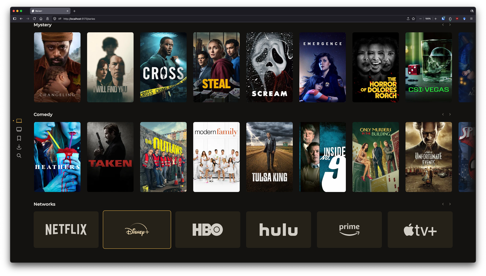
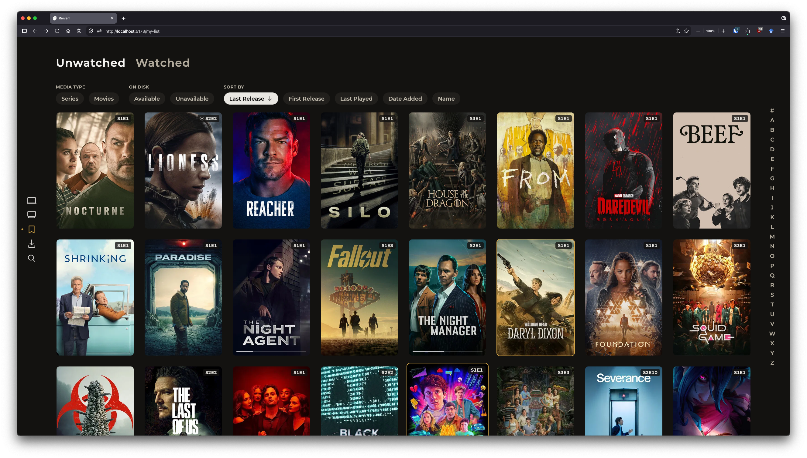
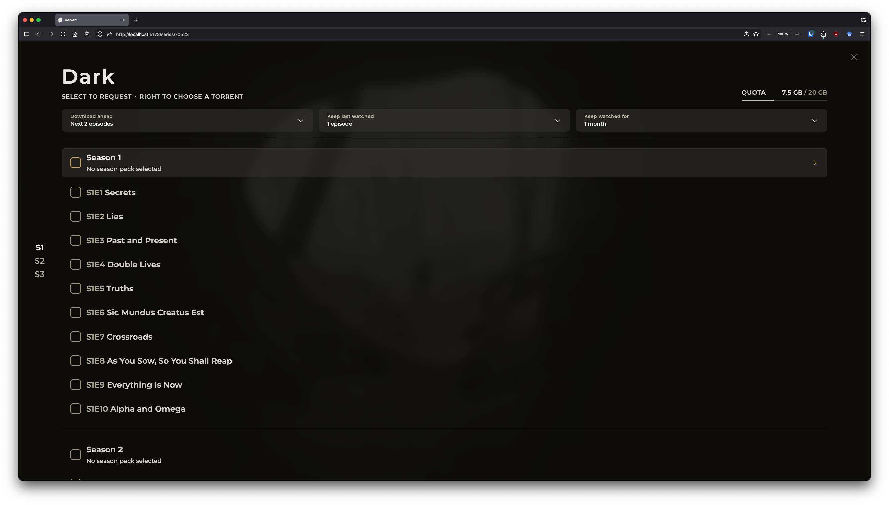
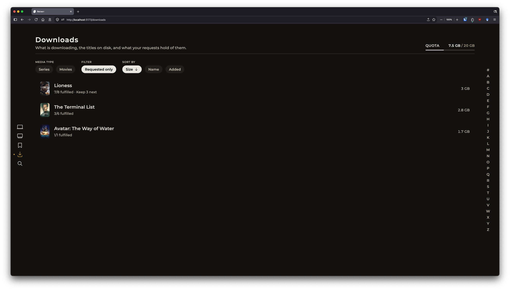
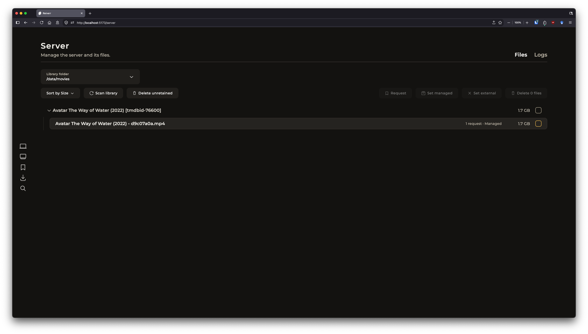

# Reiverr


Reiverr is a self hosted, TVs-first replacement for the arr stack (Jellyfin, Sonarr, Radarr, Seerr, a torrent client). See [installation](#installation) and [user guide](./docs/user-guide.md) to get started.

This project is still in early stages, and many features are still missing / being tested and changed. Contributions are welcome! See [contributing](#Contributing) for more information.

> For the old, desktop-only version that connects to Jellyfin, Radarr and Sonarr, see [1.0 branch](https://github.com/aleksilassila/reiverr/tree/v1).


# List of major features

TMDB Discovery:

- Discover trending movies and TV shows
- Get personalized recommendations based on your TMDB ratings
- View details about movies and TV shows, such as cast, crew, ratings & a trailer.
- Movie & TV show search

Requests & downloads:

- Built-in torrent client for downloading media using a requesting system
- Can be configured to download episodes only as they are needed and automatically delete them after watching
- Storage usage quotas per user
- ~~Discovery of new content via RSS~~
- ~~Limit # of concurrent downloads and download speed~~

Library:

- External files are automatically discovered from disk
- Supports multiple library folders and is compatible with jellyfin libraries

Playback:

- Direct playback (see [your browser compatibility](https://cconcolato.github.io/media-mime-support/))
- ~~Transcoding/HLS~~
- ~~Streaming from torrents~~
- Audio track selection (Tizen, or [audioTracks](https://caniuse.com/audiotracks))
- Subtitles (VTT/SRT as sidecar files)

For a list of planned features & known bugs, see [Reiverr Taskboard](https://github.com/users/aleksilassila/projects/7).

# Installation

The easiest and the recommended way to install Reiverr is via Docker. After installation, see [post-installation](#post-installation).

## Docker compose

```yaml
name: reiverr

services:
  reiverr:
    image: ghcr.io/aleksilassila/reiverr:latest
    container_name: reiverr
    ports:
      - 9494:9494
    environment:
      # Optional variables:
      # - JWT_SECRET=your_secret_here # used to sign JWT tokens for authentication. If not set, defaults to a random string and sessions will not persist between server restarts. Use a random string.
      # - ADMIN_USERNAME=admin
      # - ADMIN_PASSWORD=very_strong_password
      # - TORRENT_PORT=51413 # The port that torrent client listens on. If not set, a random port is used. It's recommend to forward this in your VPN
      # - TORRENT_DHT_PORT=51414 # DHT nodes UDP port. If not set, a random port is used. Forward as well
      # - TORRENT_UPNP=true # Enable UPnP, off by default
      # - TORRENT_NAT_PMP=true # Enable NAT-PMP, off by default
      # - TORRENT_WEBRTC=false # Disable WebRTC peers. On by default
      # - TZ=Europe/Helsinki # Time zone of the nightly cleanup and scans. UTC by default
    volumes:
      - /path/to/appdata/config:/config
      - /path/to/data:/data
      # - /path/to/downloads:/data/downloads # Optional
    restart: unless-stopped
```

## Docker CLI

```sh
docker run -it --init \
  --name reiverr \
  --restart unless-stopped \
  -p 9494:9494 \
  -v /path/to/appdata/config:/config \
  -v /path/to/data:/data \
  ghcr.io/aleksilassila/reiverr:latest
```

The `/data` volume holds the downloads (`/data/downloads`) and is meant to hold the media library too, for example `/data/tv` and `/data/movies`. When both are on the same volume, finished downloads are hard linked into the library and take no extra space; across volumes they are copied.

## Building from Source

1. Requirements(ish):
   - Node v22.17.0 or higher
   - NPM v9.3.1 or higher
2. Clone from **master** or download the [latest source](https://github.com/aleksilassila/reiverr/releases)
3. Build & run the app:\
   `npm install`\
   `npm run build`\
   `npm run start:prod`

### Reiverr will be accessible via port 9494 by default.

## Smart TVs

To be able to use Reiverr on TVs, you'll **still need to host the backend server** on a separate device. See the above methods for instructions on how to set up the backend / web app.

### Tizen / Samsung Smart TVs

Installing on a Samsung TV needs [developer mode on the TV](https://developer.samsung.com/smarttv/develop/getting-started/using-sdk/tv-device.html), with the computer you install from as its Host PC IP.

Each release has a ready-built `Reiverr.wgt` on the [releases page](https://github.com/aleksilassila/reiverr/releases), signed with the Tizen SDK's generic developer certificate. Older TVs accept it as is, but newer TVs need the package to to be signed with a [Samsung certificate made for the TV](https://developer.samsung.com/smarttv/develop/getting-started/setting-up-sdk/creating-certificates.html). Installers such as [Apps2Samsung](https://github.com/Apps2Samsung/Apps2Samsung) make the certificate and sign the package for you, or you can re-sign it with the Tizen CLI:

`tizen package -t wgt -s <certificate profile> -- Reiverr.wgt`

Alternatively, you can build and install the app from source with Docker:

1. Obtain your TV's IP address
2. Run `npm run deploy:tizen <TV_IP>` to build and install the app on your TV

To sign with your own certificates, put `author.p12` and `distributor.p12` in `tizen/certificates/` and give their password after the IP:

`npm run deploy:tizen <TV_IP> <CERTIFICATE_PASSWORD>`

An update has to be signed with the same certificate as the installed app; otherwise, uninstall the app first.

For troubleshooting, see [install-jellyfin-tizen](https://github.com/Georift/install-jellyfin-tizen), which this build method is based on.

### Android TV / Fire TV

The build has only been tested in an Android TV emulator. If you have a real TV, let me know if you run into issues.

Each release has a ready-built `Reiverr.apk` on the [releases page](https://github.com/aleksilassila/reiverr/releases). Download it on the TV with a downloader app and allow that app to install unknown apps, or install it from a computer with `adb install -r Reiverr.apk`. Fire TV models running Vega OS (the Fire TV Stick 4K Select and some newer Fire TV Stick HD models) cannot install Android apps.

In the emulator, files with Dolby (AC-3, E-AC-3) or DTS audio play without sound, and 10-bit HEVC (x265) video plays without a picture. If you try such files on a real TV, let me know how they play.

To build the APK yourself, `npm run build:android` builds the app in Docker and writes `android/Reiverr.apk`, which can be sideloaded on an Android TV or Fire TV device, or installed in the Android TV emulator of Android Studio with `adb install -r android/Reiverr.apk` (from inside the emulator, a backend on the same computer is at `http://10.0.2.2:9494`). To install it on a TV over the network:

1. Enable ADB debugging on the TV (Android TV: Settings > System > Developer options; Fire TV: Settings > My Fire TV > Developer options) and allow the connection on the TV when it asks
2. Obtain your TV's IP address
3. Run `npm run deploy:android <TV_IP>`

With Docker Desktop, `npm run deploy:android host.docker.internal` installs into an emulator running on the same computer.

The APK is signed with a key that is stored in `android/keystore/` on the first build. If you want to update the app, it needs to be signed with the same key. To sign with a keystore of your own, put it there as `reiverr.jks` and set `KEYSTORE_PASSWORD`. An APK you build is signed with a different key than the release APKs, so switching between the two means uninstalling the app first.

### WebOS

Planned

> [!NOTE]
> If you have any questions or run into issues or bugs, you can start a [discussion](https://github.com/aleksilassila/reiverr/discussions) or open an [issue](https://github.com/aleksilassila/reiverr/issues). If find a feature request that you'd like to see implemented, you can react to it with a thumbs up.

# Post Installation

To create the first user account, you can log in with any credentials and an admin account will be created. Alternatively, you can define the admin username and password using environment variables, as seen in the Docker Compose example. A new admin account is created on startup if there is no account with that name. If an admin account with that name exists, its password is reset to `ADMIN_PASSWORD` on every startup, which is also how you can recover a forgotten admin password. To change that admin's password in the app, remove `ADMIN_PASSWORD` first.

To get most out of Reiverr, it is recommended to also connect to TMDB.

You can find more detailed documentation in the [wiki](./docs/user-guide.md).

# Contributing

To see a list of missing features & known bugs that you can help with, see [Reiverr Taskboard](https://github.com/users/aleksilassila/projects/7). Feel free to also create your own issues for bug reports or feature requests, as well as discussions for general questions. Issues with the `community` label are issues that I can't or won't work on myself, and are left for the community to pick up. Feel free to work on any issues though, even without the label.

Before you contribute:

- If you are taking on an existing bug or feature ticket, it is encouraged to comment on the issue or mark yourself as an assignee at some point to avoid multiple people working on the same thing.
- If the ticket is vague or missing information, please ask for clarification in the comments.
- UI style should match the rest of the project, and it is a good idea to discuss the design beforehand, especially for larger design choices (issues labelled with `design`).
- [Conventional commits](https://www.conventionalcommits.org/en/v1.0.0/) are encouraged.
- When creating a pull request, please make sure to target the `dev` branch and mark the PR as a draft if it is a work in progress.

# Development

See [docs](./docs/backend-architecture.md) for an overview of the backend architecture.

To get started with development:

```sh
# 1. Clone the repository
# 2. Check out the `dev` branch
# 3. Install dependencies\
npm install
npm install --prefix backend
# 4. To start the frontend:
npm run dev # or npx vite --host if you want to expose the server
# 5. To start the backend:
npm run --prefix backend start:dev
```

OR

```sh
docker compose -f docker-compose.dev.yml up --build
```

Frontend will run on port 5173 and backend port 9494

## Notes

- 3.0 will primarily target TVs, so the UI must be optimized with TVs in mind. This means larger text, buttons, etc. [Design Guide for Android TV](https://developer.android.com/design/ui/tv/guides/styles/layouts) is a good resource for how to design for TVs.
- The app should support old browsers all the way to Chromium 69, as that's what used in Tizen 5.5. This means that you might not be able to use the latest browser features, or that you'll have to use a polyfill. [caniuse.com](https://caniuse.com/) is a great resource if you need to check compatibility.
  - For example older browsers don't support `gap` css property. You can use the `space-x` and `space-y` classes from Tailwind CSS to achieve the same effect.

## Useful resources

- https://developer.themoviedb.org/reference
- Network tab in the browser in Jellyfin, Radarr & Sonarr web UIs

# Additional Screenshots











# Star History

<a href="https://www.star-history.com/#aleksilassila/reiverr&type=date&legend=top-left">
 <picture>
   <source media="(prefers-color-scheme: dark)" srcset="https://api.star-history.com/svg?repos=aleksilassila/reiverr&type=date&theme=dark&legend=top-left" />
   <source media="(prefers-color-scheme: light)" srcset="https://api.star-history.com/svg?repos=aleksilassila/reiverr&type=date&legend=top-left" />
   
 </picture>
</a>
