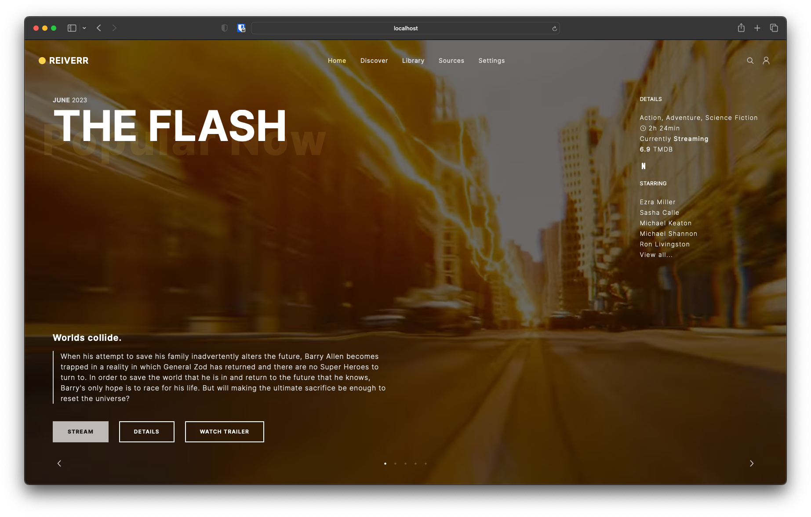
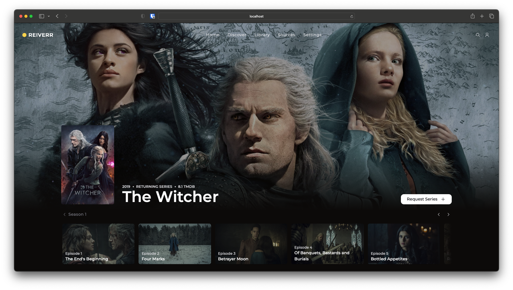
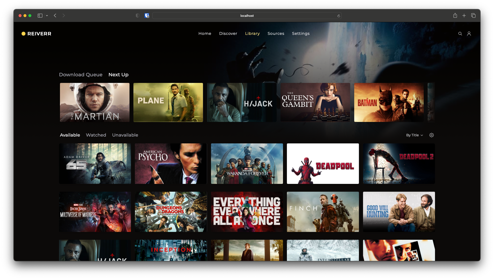

# Reiverr


Reiverr is a self hosted, TVs-first replacement for the arr stack (Jellyfin, Sonarr, Radarr, Seerr, a torrent client). See [installation](#installation) and [wiki](./docs/user-guide.md) to get started.

This project is still in early stages, and many features are still missing / being tested and changed. Contributions are welcome! See [contributing](#Contributing) for more information.

> For the old, desktop-only version that connects to Jellyfin, Radarr and Sonarr, see [1.0 branch](https://github.com/aleksilassila/reiverr/tree/reiverr-1.0).

<!-- TODO: Rename that branch to v1.0 ^ -->


# List of major features

TMDB Discovery:

- Discover trending movies and TV shows
- Get personalized recommendations based on your TMDB ratings
- View details about movies and TV shows, such as cast, crew, ratings & a trailer.
- Movie & TV show search

Requests & downloads:

- Media is automatically downloaded when requested
- Can be configured to request episodes only as they are needed
- Watched episodes can be automatically unrequested
- Media that no user requests is automatically cleaned up
- Storage usage quotas per user
- Built-in torrent client
- ~~Discovery of new content via RSS~~

Library:

- Supports multiple library folders and is compatible with jellyfin libraries
- External files are automatically discovered from disk

Playback:

- Direct playback (see [your browser compatibility](https://cconcolato.github.io/media-mime-support/))
- ~~Transcoding/HLS~~
- ~~Streaming from torrents~~
- Audio track selection (Tizen, or [audioTracks](https://caniuse.com/audiotracks))
- Subtitles (VTT/SRT as sidecar files)

For a list of planned features & known bugs, see [Reiverr Taskboard](https://github.com/users/aleksilassila/projects/5).

# Installation

The easiest and the recommended way to install Reiverr is via Docker. After installation, see [post-installation](#post-installation).

### Docker compose

```yaml
name: reiverr

services:
  reiverr:
    image: ghcr.io/aleksilassila/reiverr:latest
    container_name: reiverr
    ports:
      - 9494:9494
    environment:
      # Optional variables:
      - SECRET=your_secret_here # used to sign JWT tokens for authentication. If not set, sessions will not persist between server restarts. Use a random string.
      # - ADMIN_USERNAME=admin
      # - ADMIN_PASSWORD=very_strong_password
      # - TORRENT_PORT=51413 # The port that torrent client listens on. If not set, a random port is used. It's recommend to forward this in your VPN
      # - TORRENT_DHT_PORT=51414 # DHT nodes UDP port. If not set, a random port is used. Forward as well
      # - TORRENT_UPNP=true # Enable UPnP, off by default
      # - TORRENT_NAT_PMP=true # Enable NAT-PMP, off by default
      # - TORRENT_WEBRTC=false # Disable WebRTC peers. On by default
    volumes:
      - /path/to/appdata/config:/config
      - /path/to/data:/data
    restart: unless-stopped
```

### Docker CLI

```sh
docker run -it --init \
  --name reiverr \
  --restart unless-stopped \
  -p 9494:9494 \
  -v /path/to/appdata/config:/config \
  -v /path/to/data:/data \
  ghcr.io/aleksilassila/reiverr:latest
```

The `/data` volume holds the downloads (`/data/downloads`) and is meant to hold the media library too, for example `/data/tv` and `/data/movies`. When both are on the same volume, finished downloads are hard linked into the library and take no extra space; across volumes they are copied.

### Building from Source

1. Requirements(ish):
   - Node v22.17.0 or higher
   - NPM v9.3.1 or higher
2. Clone from **master** or download the [latest source](https://github.com/aleksilassila/reiverr/releases)
3. Build & run the app:\
   `npm install`\
   `npm install --prefix backend`\
   `npm run preview`

#### Reiverr will be accessible via port 9494 by default.

### Tizen / Samsung Smart TVs

To be able to use Reiverr on TVs, you'll **still need to host the backend server** on a separate device. See the above methods for instructions on how to set up the backend / web app.

Easiest way to install reiverr on a Samsung Smart TV is to use a provided docker image to build and install the application on tizen. To get started:

1. [Enable developer mode on your TV](https://developer.samsung.com/smarttv/develop/getting-started/using-sdk/tv-device.html)
2. Obtain your TV's IP address
3. Run `npm run deploy:tizen <TV_IP>` to build and install the app on your TV

For troubleshooting and more detailed instructions, you can see [the repository](https://github.com/Georift/install-jellyfin-tizen) that this build method is based on. In case the installation requires custom certificates, refer to the above repository. Certificate password can be provided as secondary argument after the ip.

If you have any questions or run into issues or bugs, you can start a [discussion](https://github.com/aleksilassila/reiverr/discussions) or open an [issue](https://github.com/aleksilassila/reiverr/issues). If find a feature request that you'd like to see implemented, you can react to it with a thumbs up.

## Other Platforms

The roadmap includes plans to support the following platforms in the future:

- Android TV / WebOS

# Post Installation

To create the first user account, you can log in with any credentials and an admin account will be created. Alternatively, you can define the admin username and password using environment variables, as seen in the Docker Compose example. A new admin account is created on startup if there is no account with that name. If an admin account with that name exists, its password is reset to `ADMIN_PASSWORD` on every startup, which is also how you can recover a forgotten admin password. To change that admin's password in the app, remove `ADMIN_PASSWORD` first.

To get most out of Reiverr, it is recommended to also connect to TMDB.

You can find more detailed documentation in the [wiki](./docs/user-guide.md).

# Contributing

To see a list of missing features & known bugs that you can help with, see [Reiverr Taskboard](https://github.com/users/aleksilassila/projects/7). Feel free to also create your own issues for bug reports or feature requests, as well as discussions for general questions. Issues with the `community` label are issues that I can't or won't work on myself, and are left for the community to pick up. Feel free to work on any issues though, even without the label.

Before you contribute:

- If you are taking on an existing bug or feature ticket, it is encouraged to comment on the issue or mark yourself as an assignee at some point to avoid multiple people working on the same thing.
- If the ticket is vague or missing information, please ask for clarification in the comments.
- UI style should match the rest of the project, and it is a good idea to discuss the design beforehand, especially for larger design choices (issues labelled with `design`).
- [Conventional commits](https://www.conventionalcommits.org/en/v1.0.0/) are encouraged.
- When creating a pull request, please make sure to target the `dev` branch and mark the PR as a draft if it is a work in progress.

# Development

See [docs](./docs/backend-architecture.md) for an overview of the backend architecture.

To get started with development:

```sh
# 1. Clone the repository
# 2. Check out the `dev` branch
# 3. Install dependencies\
npm install
npm install --prefix backend
# 4. To start the frontend:
npm run dev # or npx vite --host if you want to expose the server
# 5. To start the backend:
npm run --prefix backend start:dev
```

OR

```sh
docker compose -f docker-compose.dev.yml up --build
```

Frontend will run on port 5173 and backend port 9494

## Notes

- 3.0 will primarily target TVs, so the UI must be optimized with TVs in mind. This means larger text, buttons, etc. [Design Guide for Android TV](https://developer.android.com/design/ui/tv/guides/styles/layouts) is a good resource for how to design for TVs.
- The app should support old browsers all the way to Chromium 69, as that's what used in Tizen 5.5. This means that you might not be able to use the latest browser features, or that you'll have to use a polyfill. [caniuse.com](https://caniuse.com/) is a great resource if you need to check compatibility.
  - For example older browsers don't support `gap` css property. You can use the `space-x` and `space-y` classes from Tailwind CSS to achieve the same effect.

## Useful resources

- https://developer.themoviedb.org/reference
- Network tab in the browser in Jellyfin, Radarr & Sonarr web UIs

# Additional Screenshots







# Star History

<a href="https://www.star-history.com/#aleksilassila/reiverr&type=date&legend=top-left">
 <picture>
   <source media="(prefers-color-scheme: dark)" srcset="https://api.star-history.com/svg?repos=aleksilassila/reiverr&type=date&theme=dark&legend=top-left" />
   <source media="(prefers-color-scheme: light)" srcset="https://api.star-history.com/svg?repos=aleksilassila/reiverr&type=date&legend=top-left" />
   
 </picture>
</a>
