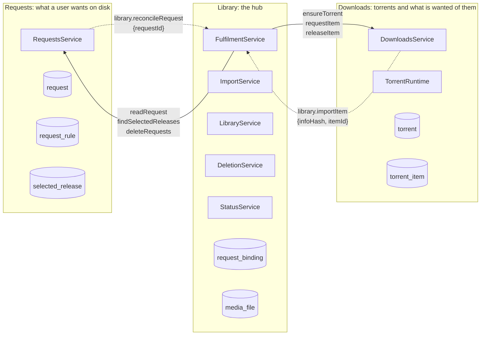
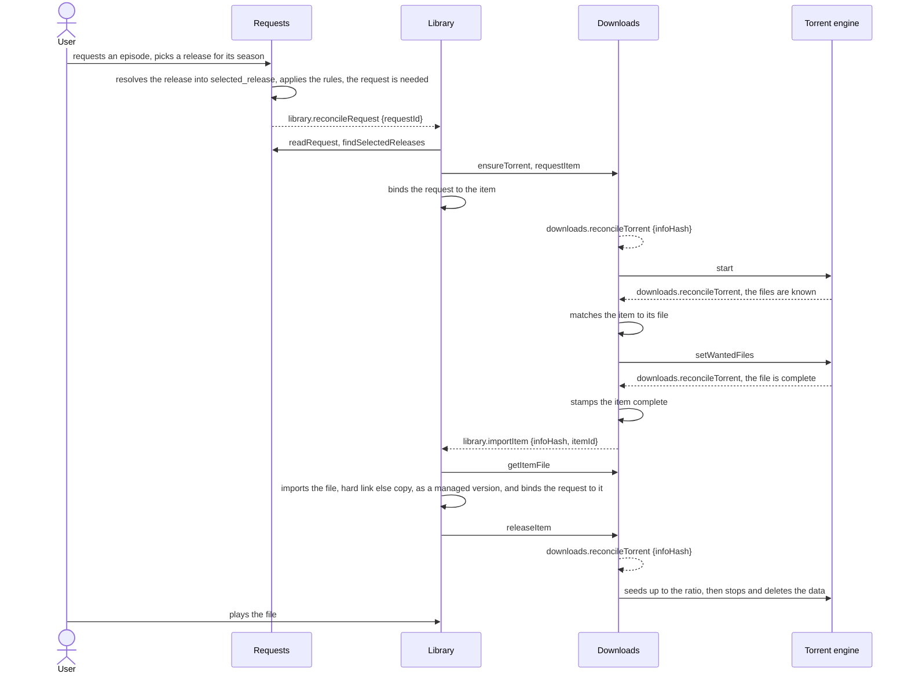
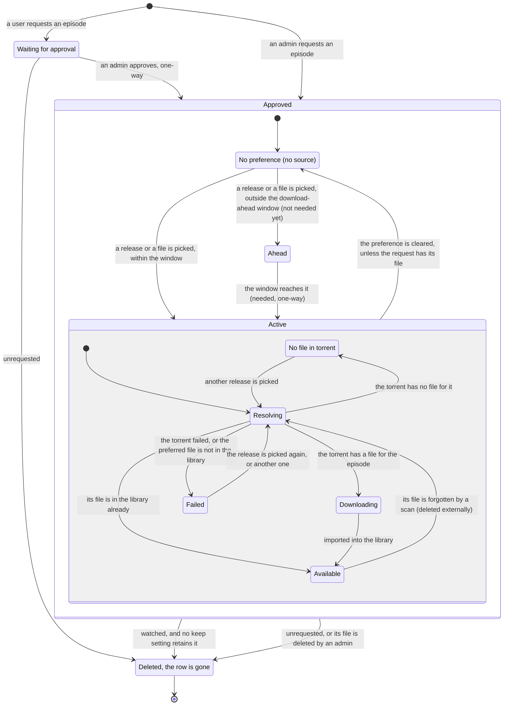
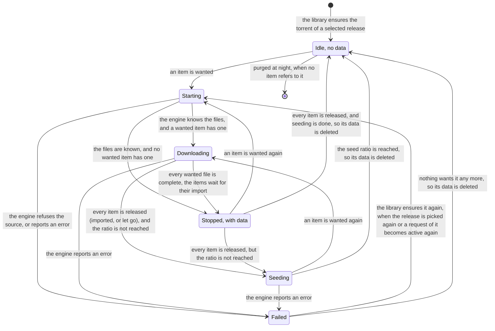
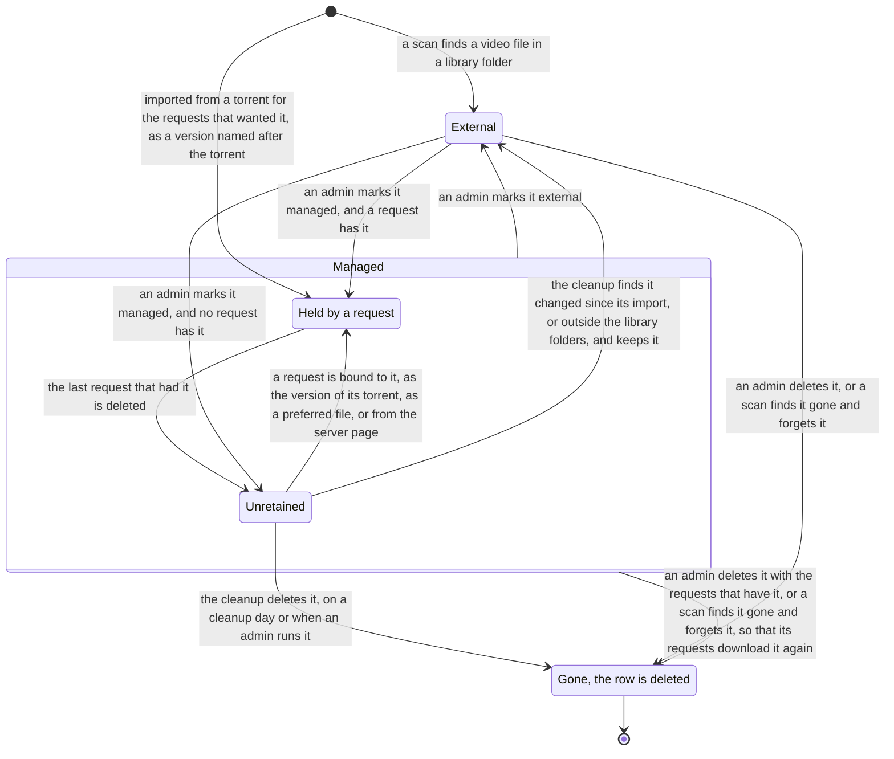

# Backend architecture

This file contains an overview of the most important parts of the backend architecture.

## Request, library and downloads modules

These modules drive the requests, files management and downloads. Requests don't know of downloads or the library, and are only responsible for reacting to users requests and watch status changes, managing which requests are active, and notifying the library of changes. Library matches requests to files on disk, or tells downloads module if a file is missing. It also takes care of disk cleanup and housekeeping.

## Request creation to fulfillment overview

The sequence of a request that goes well, from a user picking a release to the file playing: solid arrows are calls, dashed arrows are the jobs that carry the events between the modules, named by their type.

## The request lifecycle

The life of a request row, from a user's wish to its deletion: a request is inactive until it's approved and passes gates, such as user has picked a source and the episode is needed.

## The torrent lifecycle

The lifecycle of a torrent in downloads, from the library ensuring it for a selected release until its data goes: the reconcile job decides every transition from what is wanted of the torrent, what the engine reports and the seed ratio, and the row, keyed by info hash, stays until no item refers to it.

## The library file lifecycle

The lifecycle of a file in the library's index, from a scan finding it or an import placing it until its row is deleted: a file a scan found is external and never the server's to delete, an imported file is managed and stays as long as a request holds it, after which the cleanup deletes it.

